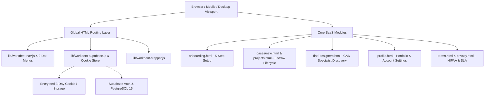
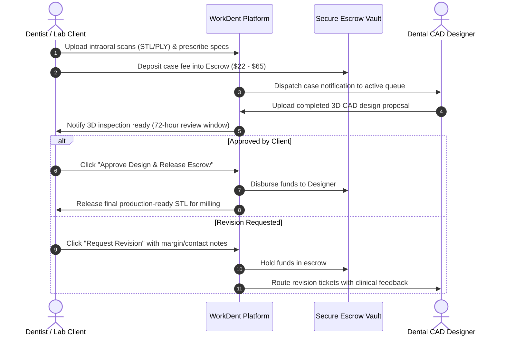

# WorkDent - System Architecture (ARCHITECTURE.md)

**System**: WorkDent &bull; The Professional Network for Dental Work  
**Edition**: Production v2.4 (Healthcare SaaS Architecture)  
**Standard**: WCAG AAA &bull; Zero-Latency Client &bull; HIPAA Compatible  

---

## 1. High-Level Architecture Overview

WorkDent is architected as an ultra-fast, static edge-delivered Progressive Web Application with an asynchronous decoupled Supabase backend and client-side session synchronizer.

---

## 2. Component Design & Responsibility Matrix

### 2.1 Global UI Engine (`css/workdent-ui.css`)
- **Tokens**: Standardized CSS variables for typography, colors, shadows, and touch metrics.
- **Color Discipline**: Enforces healthcare SaaS palette: Teal (`#087F8C`), Blue (`#2479D8`), Turquoise (`#36C9C0`), Mint (`#B9F3E8`), Deep Navy (`#102A43`), and White (`#FFFFFF`). Strictly zero purple.
- **Responsive Layout**: Fluid grids, minimum 44px touch targets on mobile, and automatic viewport-edge collision protection.

### 2.2 Navigation & Session Sync Engine (`lib/workdent-nav.js`)
- **Desktop 3-Dot More Menu**: Accessible floating dropdown menu providing access to company, solutions, and support sections without cluttering the primary navigation bar.
- **Mobile 3-Dot Drawer**: Touch-friendly slide-down drawer with automatic icon morphing (`···` to `✕`), double-binding prevention, and click-outside dismissal.
- **Authenticated Header State**:
  - Dynamically detects valid session via `WorkDentAuth.validateSession()`.
  - Replaces sign in/sign up buttons with user avatar (Google photo or custom initial) and interactive account dropdown card.
  - Dropdown items: `My Profile & Portfolio`, `Work & Cases Dashboard`, `Post / Upload Dental Case`, `Edit Profile & Location`, `Sign Out`, and `Delete Account`.

### 2.3 Backend & Authentication Engine (`lib/workdent-supabase.js`)
- **Dual-Mode Persistence**: Primary remote sync to Supabase with automatic, transparent fallback to local encrypted 3-day cookies for offline or sandboxed execution.
- **Session Security**: Enforces 3-day maximum lifespan (`Max-Age: 259,200` seconds). Automatically clears expired cookies.
- **Security Rate Limiter**: Maximum 5 failed attempts per 5-minute window; enforces 60-second cooldown timer on lockout.
- **Account Actions**: Full CRUD support including registration with mandatory terms agreement, passwordless OTP, Google OAuth simulation, profile updates, and permanent account deletion.

---

## 3. Dental Case Escrow Architecture

---

## 4. Performance & Reliability Guarantees
- **Zero 404 Pages**: All scraped Next.js chunks replaced with valid HTML pages.
- **Zero Build Step**: Runs directly in standard modern web browsers via vanilla HTML5, CSS3, and ES6+ JavaScript.
- **No Third-Party Framework Overhead**: Eliminates React hydration bugs, virtual DOM overhead, and heavy runtime JS bundles.
