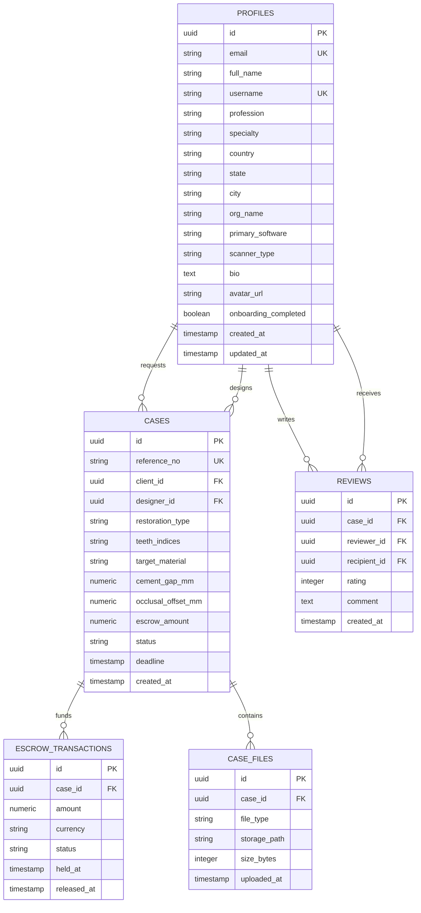

# WorkDent - Database Schema & Data Dictionary (DATABASE.md)

**Engine**: PostgreSQL 15 &bull; Supabase Managed Database  
**Extensions**: `uuid-ossp`, `pgcrypto`, `pg_trgm`  
**Security**: Row Level Security (RLS) Active on all public tables  

---

## 1. Entity-Relationship Diagram



---

## 2. Table Definitions & Schemas

### 2.1 Table: `public.profiles`
Stores verified professional identity, dental role, software competencies, and location details.

```sql
create table public.profiles (
  id uuid references auth.users on delete cascade primary key,
  email text unique not null,
  full_name text not null,
  username text unique not null,
  profession text not null check (profession in ('dentist', 'lab', 'designer', 'ceramist', 'milling', 'support', 'manufacturer', 'other')),
  specialty text,
  country text default 'United States',
  state text,
  city text,
  org_name text,
  primary_software text,
  scanner_type text,
  bio text,
  avatar_url text,
  onboarding_completed boolean default false,
  created_at timestamptz default now(),
  updated_at timestamptz default now()
);

-- Enable RLS
alter table public.profiles enable row level security;

-- Policies
create policy "Public profiles are viewable by everyone." 
  on public.profiles for select using (true);

create policy "Users can insert their own profile." 
  on public.profiles for insert with check (auth.uid() = id);

create policy "Users can update their own profile." 
  on public.profiles for update using (auth.uid() = id);

create policy "Users can delete their own profile." 
  on public.profiles for delete using (auth.uid() = id);
```

### 2.2 Table: `public.cases`
Stores clinical prescription specifications and escrow lifecycle states.

```sql
create table public.cases (
  id uuid default gen_random_uuid() primary key,
  reference_no text unique not null,
  client_id uuid references public.profiles(id) on delete set null,
  designer_id uuid references public.profiles(id) on delete set null,
  restoration_type text not null,
  teeth_indices text not null,
  target_material text not null,
  cement_gap_mm numeric(5, 3) default 0.030,
  occlusal_offset_mm numeric(5, 3) default 0.000,
  escrow_amount numeric(10, 2) not null,
  status text not null default 'review' check (status in ('draft', 'review', 'in_progress', 'hold_revision', 'completed', 'cancelled')),
  created_at timestamptz default now(),
  updated_at timestamptz default now()
);

alter table public.cases enable row level security;

create policy "Participants can view their cases." 
  on public.cases for select using (auth.uid() = client_id or auth.uid() = designer_id);

create policy "Clients can post new cases." 
  on public.cases for insert with check (auth.uid() = client_id);
```

### 2.3 Table: `public.escrow_transactions`
Handles funds segregation for 100% escrow protection.

```sql
create table public.escrow_transactions (
  id uuid default gen_random_uuid() primary key,
  case_id uuid references public.cases(id) on delete cascade,
  amount numeric(10, 2) not null,
  currency text default 'USD',
  status text not null default 'held' check (status in ('held', 'released', 'refunded', 'disputed')),
  held_at timestamptz default now(),
  released_at timestamptz
);

alter table public.escrow_transactions enable row level security;
```

---

## 3. Storage Buckets (HIPAA PHI Isolation)

1. `dental-scans`: Private bucket for client scan files (.STL, .PLY, .OBJ). Pre-signed download URLs with 15-minute expiration.
2. `cad-proposals`: Private bucket for completed 3D restorative proposals and `.dentalProject` files.
3. `avatars`: Public bucket for user profile pictures.
