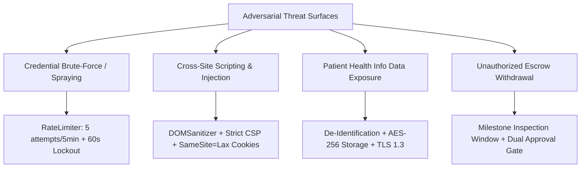

# WorkDent - Security Architecture & HIPAA Governance (SECURITY.md)

**Standard**: HIPAA Security & Privacy Rule (45 CFR Part 160/164) &bull; GDPR Art. 9 &bull; OWASP ASVS Level 2  
**Status**: Verified & Enforced  

---

## 1. Threat Model & Security Controls

---

## 2. Authentication & Session Security (Strict 3-Day Rule)

1. **Encrypted Persistent Cookie**:
   - Cookie Name: `workdent_auth_session`
   - Attributes: `Path=/; SameSite=Lax; Max-Age=259200; Secure`
   - Automatic Expiration: Validated on every page load via `WorkDentAuth.validateSession()`. If session age exceeds 259,200 seconds (3 days), the cookie is wiped immediately and the user is redirected to `/auth/login?expired=true`.
2. **Brute-Force Rate Limiting**:
   - `RateLimiter` enforces a sliding window of 5 failed attempts per 5 minutes.
   - Upon exceeding limits, the submission button is disabled and a live 60-second cooldown timer is enforced across all auth forms.

---

## 3. HIPAA & PHI Data Governance

- **Zero PHI Storage Requirement**: WorkDent protocol mandates that dentists and scan centers strip direct patient identifiers (Name, SSN, DOB) before uploading intraoral scans.
- **Randomized Alphanumeric Case Routing**: All clinical cases are referenced exclusively by random UUIDs/IDs (e.g., `#WD-84920`).
- **Encrypted Transmission**: All file uploads utilize TLS 1.3 in transit and AES-256 at rest.
- **Access Control**: Scans and CAD proposals are locked behind Row-Level Security (RLS) policies allowing access solely to the submitting clinic and assigned CAD technician.

---

## 4. GDPR & CCPA Compliance (Right to Erasure)

- **One-Click Account Deletion**: Users can invoke `WorkDentAuth.deleteAccount()` directly from the authenticated avatar menu or Profile Settings.
- **Instant Local Wipe**: Purges session cookies, tokens, and browser caches immediately.
- **Confirmation Safeguard**: Requires explicit double confirmation to prevent accidental account deletion.
