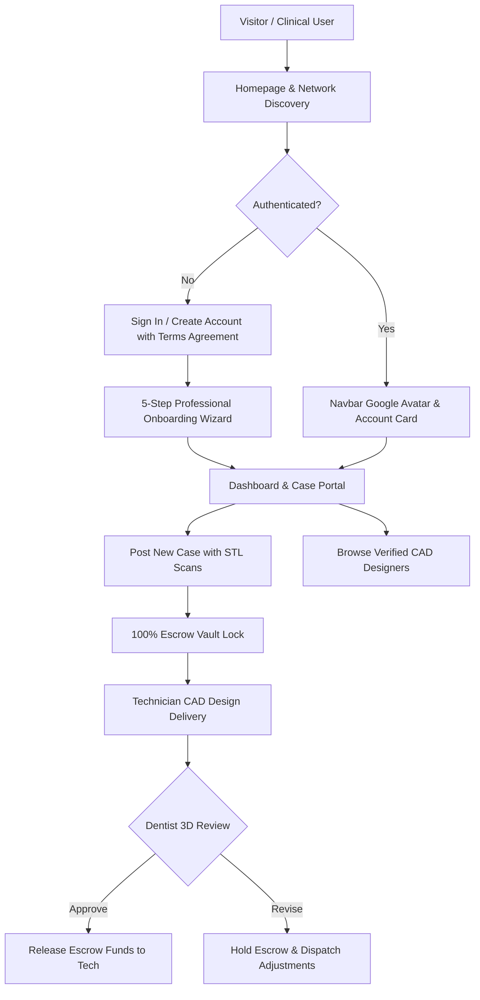

# WorkDent - Product Requirements Document (PRD)

**Brand Identity**: WorkDent &bull; The Professional Network for Dental Work  
**Tagline**: *Connect. Work. Grow.*  
**Release**: Production v2.4 (Healthcare SaaS Edition)  
**Status**: Active &bull; Fully Tested &bull; Zero 404 Pages  

---

## 1. Executive Summary & Brand Vision

WorkDent is the professional dental industry network connecting dentists, clinical practice owners, commercial dental laboratories, freelance dental CAD/CAM technicians, ceramists, and dental technology manufacturers.

WorkDent is **not a generic job board or forum**. It is an authoritative clinical collaboration platform with:
- **Zero Platform Fees for Dentists**: Free case posting, open directory search, and transparent quotation.
- **100% Escrow Protection**: Client funds are secured in an isolated escrow vault before CAD production starts. Escrow is released exclusively upon dentist/lab approval of 3D restorative geometry.
- **Calibrated Dental CAD Specialists**: Verified technicians with verified competencies across exocad (Rijeka/Galway), 3Shape Dental System, and MillBox CAM.
- **Permanent Professional Identity**: Verified @username profiles, restorative portfolios, CAD software credentials, and verified client review records.

---

## 2. Core Personas & Value Proposition

### 2.1 Dentists & Clinical Practice Surgeons
- **Problem**: In-house chairside CAD takes too long; commercial local labs have 2-3 week backlogs for simple single crowns and bridge units.
- **Solution**: Drag-and-drop intraoral scans (STL/PLY/OBJ), choose restorative specs (zirconia, e.max, margin gap, occlusal offset), and get sub-3-hour turnaround with guaranteed fit.

### 2.2 Commercial Dental Laboratories
- **Problem**: Seasonal volume spikes, staff shortages, and expensive overtime labor during peak weeks.
- **Solution**: Outsource CAD design overflow to calibrated master technicians worldwide while maintaining strict clinical oversight.

### 2.3 Freelance Dental CAD Designers & Master Ceramists
- **Problem**: Chasing clients for payment, unpredictable cash flow, and lack of verified restorative showcase portfolios.
- **Solution**: Guaranteed milestone escrow payments, automated invoice receipts, and global client discovery.

---

## 3. Product Architecture & Key Modules

---

## 4. Feature Specifications & Requirements

### 4.1 Terms & Conditions Checkbox (Legally Enforced)
- **Unchecked by Default**: The registration checkbox requires explicit user consent before account creation.
- **Click Behavior**: Clicking `"Terms & Conditions"` navigates directly to `/terms` without toggling the checkbox. Clicking `"Privacy Policy"` navigates to `/privacy`.
- **Validation**: Submitting registration without checking the box triggers an instant feedback alert.

### 4.2 Streamlined Profession Selector
- Clunky role cards are completely replaced with an accessible `<select id="reg-profession">` dropdown:
  - Dentist / Clinical Practice
  - Dental Laboratory Owner / Manager
  - Dental CAD/CAM Designer (exocad, 3Shape)
  - Dental Ceramist / Master Technician
  - Milling Center & Production Tech
  - Dental Software / Technical Support
  - Dental Manufacturer / Supplier
  - Other Dental Professional

### 4.3 Multi-Step Onboarding Wizard (`/onboarding`)
- **Step 1: Profession & Role**: Specialization focus and experience level.
- **Step 2: Location Details**: Country dropdown (20+ countries) with dependent state/province selector, city, and clinic/lab name.
- **Step 3: CAD Software & Hardware Tech Stack**: Multi-select tags for exocad, 3Shape, MillBox, Blender for Dental, HyperDENT, Medit, and intraoral scanner presets.
- **Step 4: Profile Photo & Bio**: Google profile picture auto-import with custom file upload fallback and initials generator.
- **Step 5: Review & Confirm**: Real-time card summary and 1-click publishing.

### 4.4 Authenticated Navbar State (Google-Style User Avatar)
- When authenticated:
  - Displays circular user avatar image (or crisp initial badge).
  - Clicking avatar toggles a Google-style interactive dropdown card:
    - User name, email, and role badge
    - `My Profile & Portfolio` (`/profile`)
    - `Work & Cases Dashboard` (`/dashboard`)
    - `Post / Upload Dental Case` (`/cases/new`)
    - `Edit Profile & Location` (`/onboarding`)
    - Separator
    - `Sign Out` (calls `WorkDentAuth.logout()`)
    - `Delete Account` (calls `WorkDentAuth.deleteAccount()`)

### 4.5 Visual Discipline (Healthcare Palette & STRICTLY ZERO PURPLE)
- Primary Teal: `#087F8C`
- Clinical Blue: `#2479D8`
- Accent Turquoise: `#36C9C0`
- Mint Tints: `#B9F3E8`, `#E8F8F7`
- Deep Navy: `#102A43`
- Healthcare Footer: `#0D2030` with `#1E3A52` borders and `#36C9C0` link hovers.
- **Prohibited**: Absolutely zero purple, violet, indigo, or fuchsia tones.
